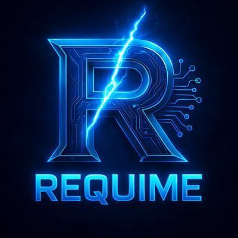
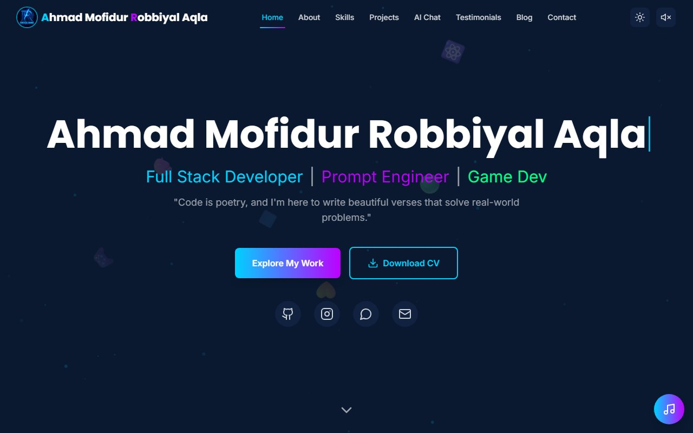
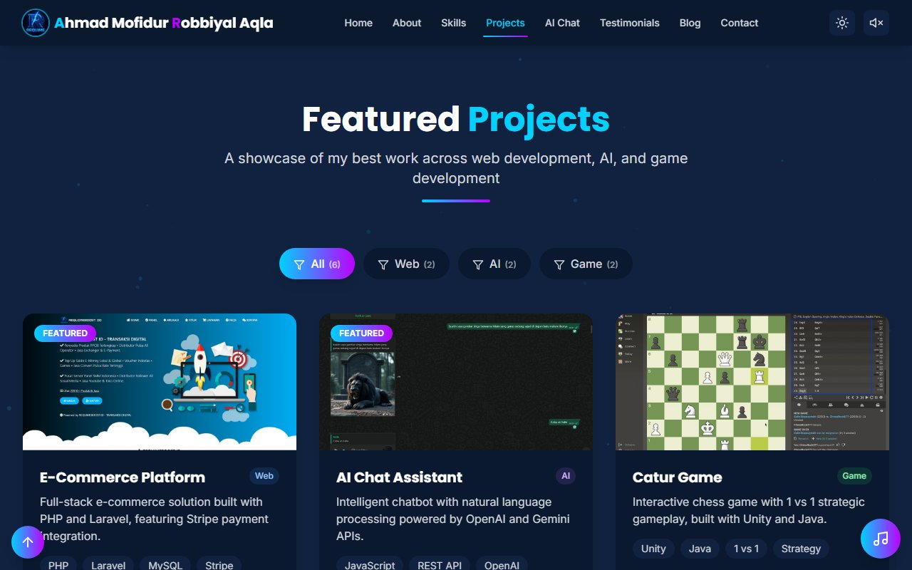
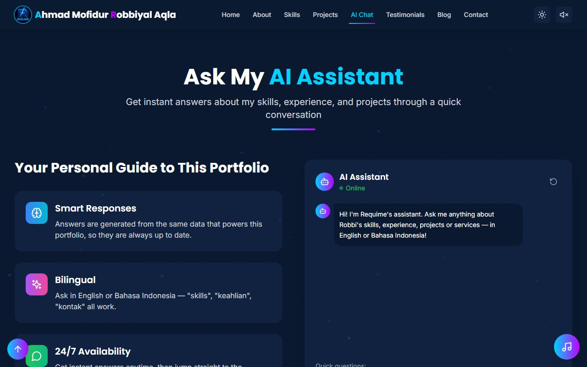
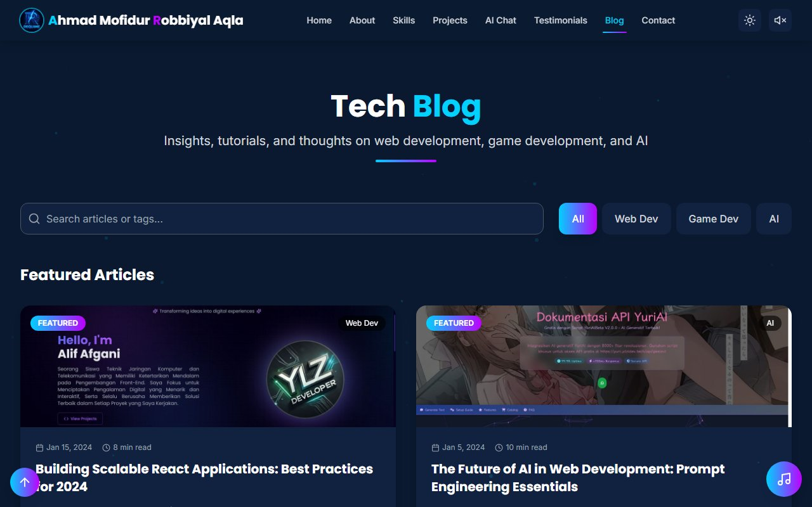
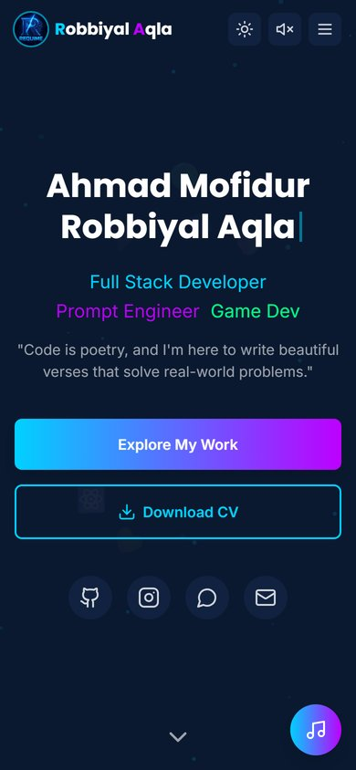

<div align="center">

<a href="https://requime.my.id">
  
</a>

# Ahmad Mofidur Robbiyal Aqla

<a href="https://requime.my.id">
  
</a>

**Portofolio pribadi Requime — tempat saya memamerkan proyek web, AI, dan game.**

<a href="https://requime.my.id"></a>
<a href="#-ambil-cv"></a>

<br />


</div>

---

## 📸 Tampilan

<div align="center">
  
</div>

<table>
  <tr>
    <td width="50%"><p align="center"><b>Projects</b> — filter Web / AI / Game</p></td>
    <td width="50%"><p align="center"><b>AI Assistant</b> — tanya apa saja, 2 bahasa</p></td>
  </tr>
  <tr>
    <td width="50%"><p align="center"><b>Tech Blog</b> — artikel lengkap + pencarian</p></td>
    <td width="50%" align="center"><p align="center"><b>Mobile friendly</b> 📱</p></td>
  </tr>
</table>

---

## ✨ Fitur Unggulan

|     | Fitur                 | Keterangan                                                                             |
| --- | --------------------- | -------------------------------------------------------------------------------------- |
| ⌨️  | **Hero interaktif**   | Efek mengetik, ikon teknologi melayang, latar partikel, tombol Download CV             |
| 🧑‍💻  | **About & Journey**   | Profil singkat (umur dihitung otomatis dari tanggal lahir) dan timeline perjalanan     |
| 🛠️  | **Tech Stack**        | 6 kategori skill dengan progress bar animasi                                           |
| 🚀  | **Projects**          | Filter kategori, link Live Demo & Source                                               |
| 🤖  | **AI Assistant**      | Chatbot berbasis data portofolio, paham Bahasa Indonesia & Inggris                     |
| 💬  | **Testimonials**      | Carousel auto-play + swipe, form kirim testimoni                                       |
| 📝  | **Tech Blog**         | 6 artikel lengkap, pencarian, filter, like, share, link langsung `#blog/<slug>`        |
| 📬  | **Contact**           | Form tervalidasi, tombol WhatsApp, dan Google Maps                                     |
| 🎵  | **Music player**      | Musik lo-fi **generatif** langsung di browser (tanpa file audio), 3 track + visualizer |
| 🌗  | **Dark / Light mode** | Pilihan tema tersimpan otomatis                                                        |
| 🎮  | **Easter eggs**       | Secret console `Ctrl + Alt + A` dengan mini game, plus kode Konami ↑↑↓↓←→←→BA          |
| ♿  | **Aksesibel & cepat** | Navigasi keyboard, label ARIA, dukungan _reduce motion_, gambar teroptimasi, SEO siap  |

---

## 🚀 Menjalankan di Lokal

```bash
git clone https://github.com/RequimeOfficial/portofolio-v2.git
cd portofolio-v2
npm install
npm run dev
```

Buka **http://localhost:5173** di browser.

| Script            | Fungsi                                 |
| ----------------- | -------------------------------------- |
| `npm run dev`     | Server pengembangan dengan hot reload  |
| `npm run build`   | Type-check + build produksi ke `dist/` |
| `npm run preview` | Pratinjau hasil build                  |
| `npm run lint`    | Cek kode dengan ESLint                 |
| `npm run check`   | Typecheck + lint + build sekaligus     |
| `npm run format`  | Rapikan kode dengan Prettier           |

---

## 🗂️ Struktur Proyek

```
src/
├── components/
│   ├── sections/      # Hero, About, TechStack, Projects, AISection, Testimonials, Blog, Contact
│   └── ui/            # Komponen kecil yang dipakai ulang (Modal, Avatar, SectionHeader, ...)
├── contexts/          # Tema & music player
├── data/              # ✏️ SEMUA konten situs ada di sini
├── hooks/             # Scrollspy & easter egg
└── lib/               # Asisten AI, mesin musik, pengiriman form, utilitas
public/
├── cv/                # File CV yang bisa diunduh
└── images/            # Gambar proyek & blog
```

---

## ✏️ Mengubah Konten

Semua isi website cukup diubah di folder **`src/data/`**, tanpa menyentuh komponen:

| File              | Isi                                                                    |
| ----------------- | ---------------------------------------------------------------------- |
| `profile.ts`      | Nama, bio, tanggal lahir, kontak, lokasi & peta, sosial media, layanan |
| `projects.ts`     | Daftar proyek                                                          |
| `skills.ts`       | Tech stack, statistik, timeline                                        |
| `testimonials.ts` | Testimoni klien                                                        |
| `posts.ts`        | Artikel blog                                                           |

<a id="-ambil-cv"></a>

> 📄 **CV**: file ada di [`public/cv/Ahmad-Mofidur-Robbiyal-Aqla-CV.pdf`](public/cv/Ahmad-Mofidur-Robbiyal-Aqla-CV.pdf). Ganti dengan versi terbaru kapan saja (nama file sama).

---

## 📬 Form Kontak

Tanpa konfigurasi apa pun, form akan membuka aplikasi email pengunjung dengan pesan yang sudah terisi.
Supaya pesan **langsung masuk ke inbox**, buat access key gratis di [web3forms.com](https://web3forms.com):

```bash
cp .env.example .env
# lalu isi: VITE_WEB3FORMS_KEY=xxxxxxxx
```

Saat deploy, tambahkan environment variable `VITE_WEB3FORMS_KEY` yang sama di dashboard hosting.

---

## 🌐 Deploy

Situs ini statis dengan domain resmi **[requime.my.id](https://requime.my.id)**.

1. Import repo ini di [Vercel](https://vercel.com/new) atau [Netlify](https://app.netlify.com/start). Vite terdeteksi otomatis (build: `npm run build`, output: `dist`).
2. Tambahkan domain kustom `requime.my.id` di pengaturan **Domains**.
3. Arahkan DNS domain ke hosting sesuai petunjuk yang muncul (record `A` / `CNAME`).

---

## 📞 Kontak

<div align="center">

<a href="https://requime.my.id"></a>
<a href="mailto:robbiansah363@gmail.com"></a>
<a href="https://wa.me/6281252517329"></a>
<br />
<a href="https://github.com/RequimeOfficial"></a>
<a href="https://instagram.com/requime__"></a>
<a href="https://maps.app.goo.gl/BUKFJa5YMDehFiqw8?g_st=ic"></a>

<br /><br />

⭐ Kalau suka dengan portofolio ini, jangan lupa kasih **star** ya!

<sub>© 2026 Ahmad Mofidur Robbiyal Aqla · Made with ❤️ in Sumenep, Indonesia</sub>

</div>
